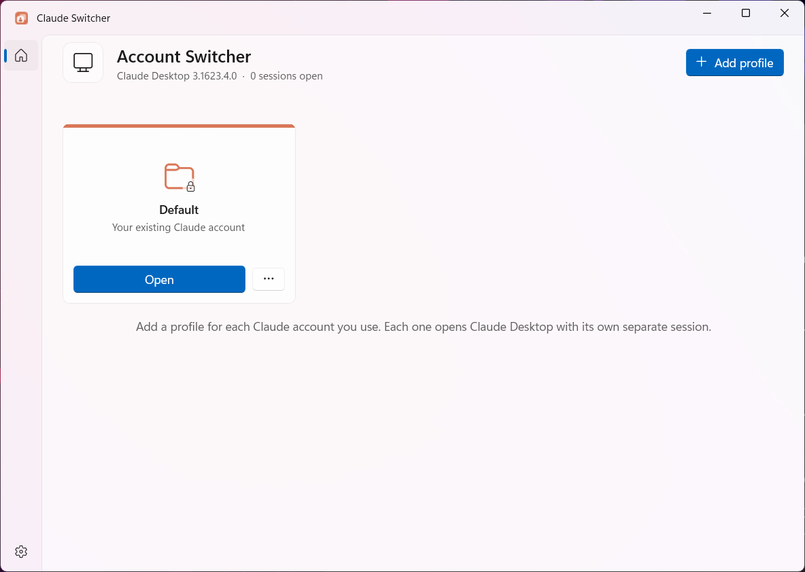
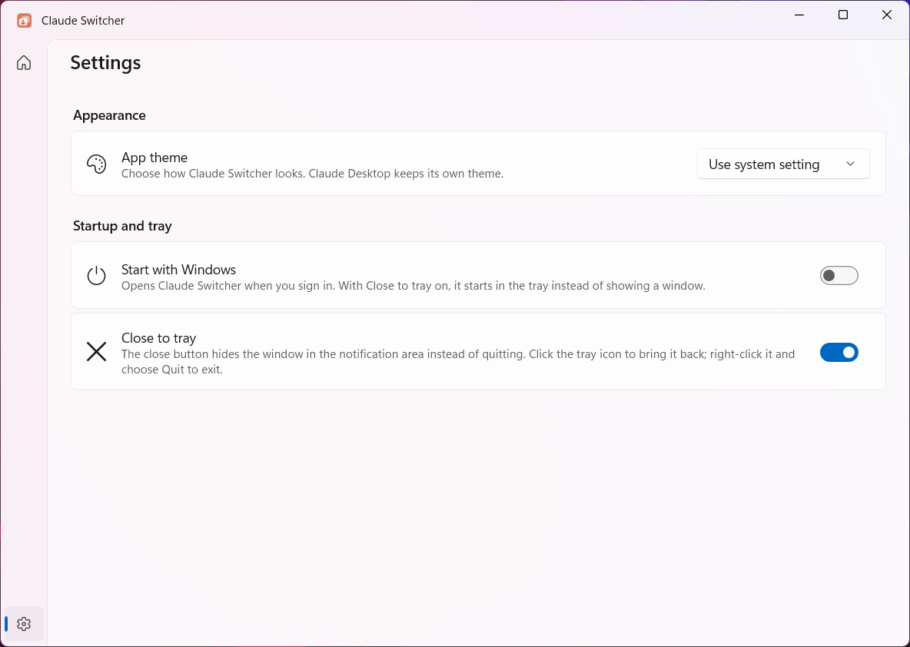

<p align="center">
  
</p>

<h1 align="center">Claude Switcher</h1>

<p align="center">
  <strong>Run several Claude Desktop accounts side by side on Windows, each in its own separate session. Built with C++/WinRT and WinUI 3, because one Claude window was apparently not enough.</strong>
</p>

<p align="center">
  
  
  
  
  
</p>

<p align="center">
  <a href="../../releases/latest">
    
  </a>
</p>

<p align="center">
  
</p>

> [!NOTE]
> Claude Switcher is an independent project. It is **not made, endorsed, or supported by Anthropic**. It does not modify Claude Desktop; it starts the copy you already installed, with a different data folder. "Claude" is a trademark of Anthropic, used here only to say which app this works with.

## What is this thing?

Claude Desktop signs into one account at a time. If you have a personal account, a work account, and a client account, the official answer is to sign out and back in until one of them gives up. The idea came from a [r/ClaudeAI thread](https://www.reddit.com/r/ClaudeAI/comments/1rkdigx/how_are_you_managing_multiple_accounts_on_claude/) full of people asking the same question.

Claude Switcher fixes that by giving every account its own **profile**. A profile is a separate Claude data folder, so it keeps its own sign-in, settings, MCP servers and cached data. Open as many profiles as you like at the same time; they never see each other.

It is a real native Windows app. Not Electron, not a WebView, and not a browser tab wearing a window costume. Which is a little ironic, since the thing it launches is an Electron app.

## What currently works?

| Area | Current behavior |
| --- | --- |
| Profiles | Add, rename, recolour and delete profiles, each with an optional note such as the account's email |
| Side by side | Every profile opens its own Claude Desktop window; open several at once, plus your original account |
| Focus | Pressing **Focus** on a running profile brings its window to the front instead of starting a second copy |
| Live status | Cards show which profiles are running, including ones started from shortcuts, and refresh every two seconds |
| Default card | Your existing Claude account, untouched; Claude Switcher never moves or changes its data |
| Shortcuts | One-click desktop shortcuts for any profile (Default included) and Start menu entries under **Claude Profiles** |
| Safe delete | A running profile cannot be deleted; a stopped one goes to the Recycle Bin, shortcuts included |
| Settings | Light, dark or system theme, start with Windows, and close to tray |
| Tray | With **Close to tray** on, the close button hides the window to the notification area; right-click the icon to quit |

<p align="center">
  
</p>

## How it works

Claude Desktop is an Electron app, and Electron honours Chromium's `--user-data-dir` switch. Claude Switcher starts Claude through its `claude-desktop.exe` app execution alias with:

```text
claude-desktop.exe --user-data-dir=%USERPROFILE%\ClaudeProfiles\<profile>
```

Going through the alias matters. Claude Desktop is an MSIX app, and starting its executable directly from `WindowsApps` would lose the package identity Claude relies on.

Claude keeps one single-instance lock **per data folder**, which is the whole trick. Different profiles therefore run side by side, and starting a profile that is already running simply hands over to the running window, which brings itself forward.

To show which profiles are running, Claude Switcher lists processes that carry Claude's package identity, keeps only the package's own `Claude.exe` main processes, and reads their `--user-data-dir`. That deliberately ignores Chromium helper processes and the Claude Code CLI, which is also called `claude.exe` and has caused more than one confused stare.

A few constraints shaped the design:

- **Profile folders live in `%USERPROFILE%\ClaudeProfiles`, never under AppData.** Windows redirects Claude's AppData writes into its package's private storage, so a profile there would quietly end up somewhere else.
- **Folder names are fixed when a profile is created.** Renaming a profile only changes its label, so a Claude window that is using the folder never loses it.
- **Your original account stays where Claude put it.** The Default card launches Claude with no switch at all.

## Signing in to a new profile

> [!IMPORTANT]
> Sign in to a new profile with the **code Claude emails you**.

Browser sign-in links and Google sign-in come back through the `claude://` link handler. Windows always gives that link to the Default Claude window, not to the profile you are setting up. The Default window stays signed in to your account; it just shows a sign-in screen until you restart it. Claude Switcher shows this tip until you dismiss it.

Taking over `claude://` would fix it, but that handler belongs to Claude's package, and fighting Windows' protected default-app settings is how you end up with a computer that opens links in nothing at all.

## Requirements

- Windows 11 x64. Windows 10 may work but is untested.
- Claude Desktop from [claude.ai/download](https://claude.ai/download), the MSIX build.
- The `claude-desktop.exe` app execution alias turned on, which it is by default. If it is off, Claude Switcher says so and points to *Settings > Apps > Advanced app settings > App execution aliases*.

## Build and run

You need Visual Studio 2026 with **Desktop development with C++** and the **Windows App SDK C++** component. Run this from the repository root in PowerShell:

```powershell
$vswhere = "${env:ProgramFiles(x86)}\Microsoft Visual Studio\Installer\vswhere.exe"
$msbuild = & $vswhere `
  -latest `
  -products * `
  -requires Microsoft.Component.MSBuild `
  -find "MSBuild\**\Bin\amd64\MSBuild.exe" |
  Select-Object -First 1

& $msbuild "ClaudeSwitcher.slnx" -t:Restore -p:RestorePackagesConfig=true

& $msbuild "ClaudeSwitcher.slnx" `
  -p:Configuration=Release `
  -p:Platform=x64 `
  -m `
  -v:m

& ".\x64\Release\CoreTests.exe"
& ".\x64\Release\ClaudeSwitcher\ClaudeSwitcher.exe"
```

Claude Switcher is unpackaged and carries its own Windows App SDK runtime, so it runs straight from the build output. There is no package to register, and the `x64\Release\ClaudeSwitcher` folder can be copied anywhere and run as is.

`CoreTests.exe` covers the parts that are easy to get subtly wrong: Chromium switch parsing, argument quoting, profile validation, the profile store, settings, shortcut files and the startup registration. It prints one line per test group and exits non-zero on failure.

## Building the installer

```powershell
& ".\tools\Build-Installer.ps1"
```

This restores packages, builds Release, runs `CoreTests.exe`, checks that every binary in the output depends only on files beside it or on Windows itself (and never on the Visual C++ runtime), then compiles `installer/ClaudeSwitcher.iss` with [Inno Setup 6](https://jrsoftware.org/isdl.php). The result is `installer/Output/ClaudeSwitcher-<version>-Setup.exe`, and the script prints its SHA-256. Add `-SkipBuild` to package an existing Release output; the tests and the dependency check still run.

The version lives in one place, `build/Version.props`. It is stamped into `ClaudeSwitcher.exe`, and the build stops if the two ever disagree.

The installer is all-users: it asks for administrator rights and installs to `Program Files\Claude Switcher`. It adds a Start menu shortcut, offers an optional desktop shortcut, and closes a running copy (even one hidden in the tray) before upgrading or uninstalling. Uninstalling removes the "Start with Windows" entry and asks before deleting the switcher's settings. It never touches `%USERPROFILE%\ClaudeProfiles`, because those folders hold your Claude sign-ins.

The installer is unsigned, so Windows SmartScreen shows an unknown-publisher warning on first run. Choose "More info", then "Run anyway".

## Where things live

| What | Where |
| --- | --- |
| Profile data folders | `%USERPROFILE%\ClaudeProfiles\<profile>` |
| Profile list | `%LOCALAPPDATA%\ClaudeSwitcher\profiles.json` |
| Preferences | `%LOCALAPPDATA%\ClaudeSwitcher\settings.json` |
| Start with Windows | `HKCU\Software\Microsoft\Windows\CurrentVersion\Run`, value `ClaudeSwitcher` |
| Start menu entries | `Start Menu\Programs\Claude Profiles` |
| Your original Claude data | Wherever Claude keeps it, untouched |

The profile list is written to a temporary file and swapped in atomically, so a crash mid-save cannot leave half a file. If the list is ever unreadable, it is renamed aside as `profiles.json.corrupt-<timestamp>` instead of being thrown away. Preferences live in their own file, so a broken preference can never cost you your profiles.

Claude Switcher sends nothing over the network. Your Claude sign-ins stay inside each profile's Claude data folder, where Claude put them; Claude Switcher never reads them.

## Known limits

- **One sign-in path per profile.** See [Signing in to a new profile](#signing-in-to-a-new-profile).
- **Cowork downloads its own VM per profile.** If you use Cowork in several profiles, each one may download its own copy, which is several gigabytes.
- **One taskbar group.** Every Claude window identifies itself as the same app, so profiles share one taskbar button group. The card colours only appear inside Claude Switcher.
- **The card shows what you typed.** Claude does not store the signed-in email anywhere Claude Switcher can safely read, so the note on each card is yours to keep accurate.

## Repository map

```text
Claude Switcher/
|-- ClaudeSwitcher.slnx
|-- src/Core/                Profiles, settings, launching, process detection,
|                            shortcuts, startup registration. No UI.
|-- src/ClaudeSwitcher/
|   |-- Shell/               Window, side panel, tray icon, single instance
|   |-- ViewModels/          Page state and commands
|   |-- Views/               WinUI pages and dialogs
|   `-- Assets/              App icon
|-- tests/CoreTests/         Console tests for the Core library
|-- tools/                   Installer build and dependency check
|-- installer/               Inno Setup script (output is ignored)
|-- docs/images/             README images
|-- licenses/                Third-party license and notice files
|-- build/                   Shared MSBuild settings and the version number
`-- packages/                Restored NuGet packages, intentionally ignored
```

## License

Claude Switcher is **source available, not open source**. The source is published under the [Last Projects License 1.0](LICENSE).

In short, personal noncommercial study, building, running, forking, and modification are permitted subject to the full license. Organizational use, commercial use, private derivatives beyond the publication window, binary redistribution, and AI use require separate permission. The license text controls if this summary misses a detail.

The [project notice](NOTICE.txt) and the [Last Projects Universal Terms and Conditions](TERMS-AND-CONDITIONS.md) also apply. Third-party components retain their own licenses, collected in [THIRD-PARTY-NOTICES.txt](THIRD-PARTY-NOTICES.txt) and [licenses/third-party](licenses/third-party).

For commercial or other permissions, contact `info@lastprojects.com`.

## Project status

This is an actively developed personal tool, not an official Anthropic product. It depends on how Claude Desktop handles `--user-data-dir` today. If a Claude update ever stops honouring it, every profile would open your Default account instead, so check the first launch after a big Claude update.

Bug reports with exact reproduction steps are welcome. Code contributions are accepted only after a separate Contributor License Agreement is arranged, as required by the license.

## Credits

- [Anthropic](https://www.anthropic.com/) for Claude and Claude Desktop, which this project only launches and never touches.
- The [r/ClaudeAI community](https://www.reddit.com/r/ClaudeAI/comments/1rkdigx/how_are_you_managing_multiple_accounts_on_claude/) for the question that started this.
- The Chromium and Electron projects, whose `--user-data-dir` switch makes the whole thing possible.
- Microsoft for C++/WinRT, WinUI 3, the Windows App SDK and WIL.
